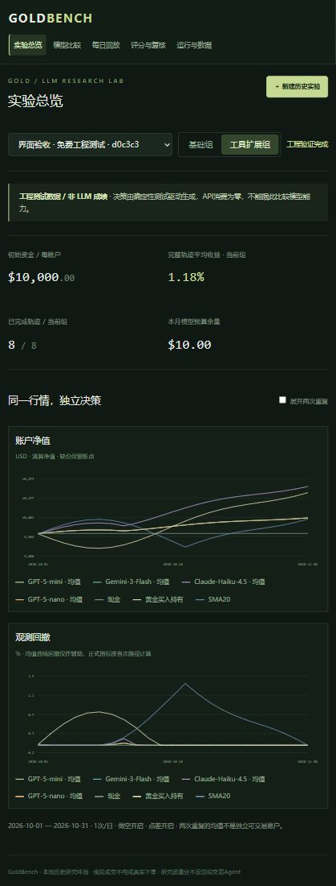

# GoldBench

**黄金场景的 LLM 自主研究与交易评测平台。**

在相同市场数据、信息截止和账户规则下，让多个 Agent 独立研究、提交预测和目标仓位，再通过交易收益、预测误差、决策证据及研究成本进行比较。

当前版本 **v0.1.0** 聚焦本地历史回测。前端采用 React + TypeScript，后端采用 FastAPI，独立 Python worker 执行回测，SQLite 保存实验状态与证据。

> 当前已验证工程测试流程，尚未完成真实 Poe 模型的兼容与费用校准。示例界面使用合成行情和确定性测试驱动，不代表图例中模型的实际表现；本项目不执行真实交易。

## 功能

- **独立账户与实验分组**：默认4个模型、基础/工具扩展两组、每组2次重复，共16条 Agent 轨迹；另提供现金、黄金买入持有和 SMA20 三个基准。
- **确定性交易引擎**：每账户初始10,000美元，日频模拟成交，默认允许做空、最多1倍敞口、开启买卖点差；区分保持数量与目标仓位再平衡。
- **按需工具路由**：先展示全部17项研究工具目录，按名称或分类加载完整参数定义，不限制加载数量、选择次数和研究调用次数；路由独立留档，有界模式对结果做UTF-8截短，总量预算模式保留完整结果。
- **研究与证据记录**：工具调用、返回内容、决策理由、预测、成交与费用可追溯；按信息截止过滤数据，隔离各 Agent 的历史记忆。
- **数据输入**：合成工程行情、已有本地审计数据、JSON导入，以及 Tushare 黄金日线/新闻按需获取与缓存。
- **运行控制**：独立 worker、冻结配置、检查点、暂停/恢复、预算预留及 JSON/CSV 导出。
- **评测与复核**：净收益、回撤、MAE、Brier；双裁判盲评代码、人工复核、NA与分歧处理。真实裁判调用仍需校准。
- **研究界面与实时监测**：实验总览、模型比较、每日回放、评分与复核、运行与数据；新增 `/monitor`，按日期查看净值、仓位、决策、工具参数/结果及执行状态。

## 界面预览

以下截图是免费工程实验，用于展示交互和数据流，不用于模型能力排名。



## 快速开始

### 环境

- Python 3.11+。
- Node.js 22.12+ 与 npm。
- 当前启动/停止脚本面向 Windows PowerShell；后端与前端可在其他系统分别启动。
- 免费工程验证不需要 Tushare 或 Poe 密钥。

在**项目根目录**执行：

```powershell
python -m venv .venv
.\.venv\Scripts\python.exe -m pip install -r requirements.txt

cd frontend
npm ci
npm run build
cd ..

.\scripts\start_goldbench.ps1
```

然后打开 [本地界面](http://127.0.0.1:8765)。服务仅监听本机，端口为 `8765`。

在当前已配置好的电脑上，依赖和构建产物已经随项目迁入，直接运行启动脚本即可。

### 运行第一个免费实验

1. 点击“新建历史实验”。
2. 行情来源选择“工程测试行情”，决策驱动选择“确定性测试驱动”。
3. 点击“仅检查数据与预算”，再“创建并运行”。
4. 在总览查看净值与回撤，在每日回放查看决策、证据和成交。
5. 在运行页导出 JSON/CSV；评分页可验证匿名人工复核流程。

测试驱动不会调用 Poe；界面始终显示“工程测试数据 / 非 LLM 成绩”。关闭网页不会停止 worker。关机后重新启动服务即可；未知付费请求不能盲目自动重试。

停止服务前，建议先在运行页暂停并等待在途任务落定：

```powershell
.\scripts\stop_goldbench.ps1
```

## 连接真实数据与模型

应用仅从后端环境变量读取凭证：

- `TUSHARE_TOKEN`：用于已授权的行情和新闻查询。
- `POE_API_KEY`：用于真实模型和裁判请求。
- `DASHSCOPE_API_KEY`：用于百炼北京 Qwen、DeepSeek V4 Pro 和 DeepSeek V4.1 Flash。

启动器也会读取当前 Windows 用户配置的同名环境变量。`python -m goldbench.server`、worker及试跑入口也支持读取被忽略的 `runtime/qwen.env`，仅接受模型Key和Tushare Token；不要把密钥写进项目配置、截图或提交记录。

真实模型运行需要有效行情、冻结的当前单价、实际模型参数以及已完成的兼容验证。通过界面的高级 JSON 配置传入 `prices`、`model_parameters`、`paid_enabled` 和 `compatibility_verified`。这些开关不是自动校准的证明。

默认模式每月10美元，研究、裁判、试跑与重试共用预算。Flash另支持 `total_tokens_only`：仅全实验1M token硬上限，不按每日研究额度或月度费用强制收尾。API费用按冻结价格与实际 usage 估算，不等同供应商官方账单。缺价、兼容失败或预算不足时不会自动换成测试驱动生成结果。

详见[运行与开发说明](LOCAL_DEVELOPMENT.md)、[Agent工具说明](docs/AGENT_TOOLS.md)、[GRAM覆盖与缺项](docs/GRAM_GAPS.md)和[设计概要](docs/DESIGN.md)。

## 目录结构

```text
GoldBench-App/
├── goldbench/             # API、worker、账户引擎、数据与模型适配、裁判
├── frontend/             # React / TypeScript 界面与构建配置
├── tests/                # 账户、时间隔离、预算、回测与裁判测试
├── scripts/              # 本地启动 / 停止脚本
├── docs/
│   ├── DESIGN.md         # 可随项目提交的设计概要
│   ├── images/           # 工程界面截图
│   └── local/            # 完整本地讨论/设计文件，不提交
├── data/local/           # 本地行情与审计输入，不提交
├── runtime/              # SQLite、实验记录、日志与进程状态，不提交
├── requirements.txt
├── LOCAL_DEVELOPMENT.md
└── README.md
```

论文、参考仓库、原始调研笔记与下载脚本不属于本应用仓库，继续保留在上级调研工作区。

## 开发与测试

```powershell
# 在项目根目录运行离线测试
New-Item -ItemType Directory -Force tmp | Out-Null
.\.venv\Scripts\python.exe -m pytest tests -q --basetemp=tmp/pytest-local

# 前端类型检查与生产构建
cd frontend
npm run build
```

后端服务与 worker 可以分别启动（同一数据库只运行一个 worker）：

```powershell
.\.venv\Scripts\python.exe -m uvicorn goldbench.api:app --host 127.0.0.1 --port 8765
# 在另一终端运行
.\.venv\Scripts\python.exe -m goldbench.worker
```

macOS/Linux 可将上述 Python 路径替换为 `.venv/bin/python`。前端生产构建由 FastAPI 统一提供；无需单独启动前端开发服务器。

当前包含132项离线测试，外部模型请求通过模拟响应验证。当前测试覆盖不代表真实供应商接口、Docker或所有研究数据已经实测。

## 当前限制

- **供应商验证范围有限**：百炼模型已接入兼容性校准与实际usage核账；Poe bot、参数与积分计费仍需独立验证。
- **历史数据不是随仓库提供的完整数据集**：已有十月黄金审计存在预定工作日缺行；不据此发布完整正式排行榜，也不擅自平移日期或补价格。
- **研究数据工具**：已接入沪金、上金所、会员持仓、仓单、美债利率、中国宏观和财经日历；日线可用时间为明确标注的保守假设。宏观修订值及财经日历缺少当时版本时返回不可用，支持导入带 `available_at` 的核验快照。网页仍仅读取存档。详见[工具说明](docs/AGENT_TOOLS.md)。
- **Python 工具**：需要本机 Docker 与预先存在的 `python:3.11-slim` 镜像；不可用时返回明确错误，不回退到宿主执行。
- **上下文管理待改进**：尚未实现研究上下文的滚动压缩及完整结果按需回读；总量预算模式会重复携带原始结果，可能在首日研究耗费大量输入。
- **首版范围**：尚未实现前瞻常驻调度、真实数据到达延迟回放、融资费启用和未知付费请求自动对账。

## GitHub 提交范围

提交源码、测试、依赖清单/锁文件、启动脚本、README、设计概要和工程截图即可。

`.gitignore` 排除了凭证文件、本地原始数据、讨论归档、运行数据库、依赖目录、日志与临时文件。新克隆可直接运行免费工程验证；“已有审计数据”选项需要自行放入合法取得的本地数据。

首次公开发布前，确认第三方数据的使用范围，并自行选择项目许可证；目前尚未指定开源许可证，不应视为已授予开源许可。
